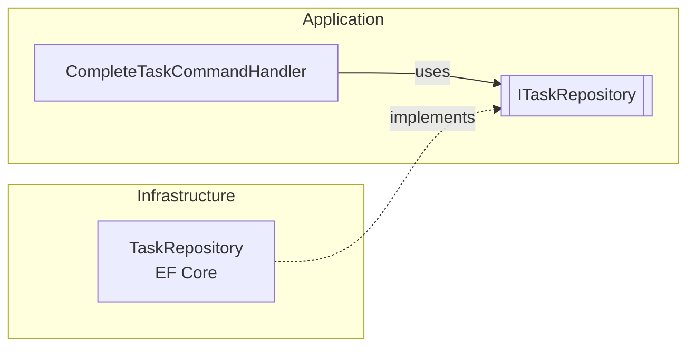
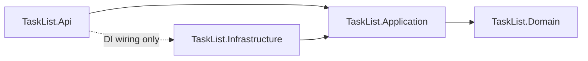
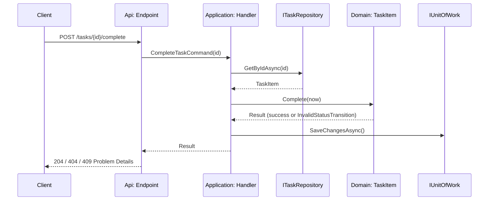

# Learn: Clean Architecture in this project

This is a **study guide**. It explains what Clean Architecture is, which problem it solves, its main
concepts, and how each concept shows up in this Task List backend.

Read it before the other docs:

| Doc | What it answers |
|---|---|
| **This doc** | *Why* the project is shaped the way it is |
| [01 – Business rules](01-business-rules.md) | *What* the system does |
| [02 – Tech stack & architecture](02-tech-stack.md) | *How* it is built |
| [03 – Development tasks](03-development-tasks.md) | *In which order* it is built |

> The code snippets below are sketches that follow the conventions in [02-tech-stack.md](02-tech-stack.md).
> The real code may differ in small details; the ideas will not.

---

## 1. What is Clean Architecture?

Clean Architecture is a way of organizing code proposed by Robert C. Martin ("Uncle Bob") in 2012.
It is a summary of older ideas that all share the same goal — Hexagonal Architecture (Ports & Adapters),
Onion Architecture and DCI:

> **Keep the business rules in the center, independent of everything else.
> Treat the database, the web framework and the UI as replaceable details.**

It is usually drawn as concentric circles:

```text
        ┌───────────────────────────────────────────────────────────┐
        │  Frameworks & Drivers   (ASP.NET Core, EF Core, Postgres) │
        │   ┌───────────────────────────────────────────────────┐   │
        │   │  Interface Adapters   (endpoints, repositories,    │   │
        │   │                        Result → HTTP mapping)      │   │
        │   │   ┌───────────────────────────────────────────┐   │   │
        │   │   │  Use Cases   (CreateTask, CompleteTask…)   │   │   │
        │   │   │   ┌───────────────────────────────────┐   │   │   │
        │   │   │   │  Entities   (TaskItem, Category)   │   │   │   │
        │   │   │   └───────────────────────────────────┘   │   │   │
        │   │   └───────────────────────────────────────────┘   │   │
        │   └───────────────────────────────────────────────────┘   │
        └───────────────────────────────────────────────────────────┘

                 source code dependencies point INWARDS  ──►  ●
```

- The **center** is the most stable and most valuable part: the business rules.
- The **edge** is the most volatile part: frameworks, libraries, databases, HTTP.
- The further out a piece of code is, the more "detail" it is.

---

## 2. Which problem does it solve?

### 2.1 The "everything in the controller" design

Imagine implementing "complete a task" (UC-11) the quick way:

```csharp
app.MapPost("/tasks/{id}/complete", async (Guid id, AppDbContext db) =>
{
    var task = await db.Tasks.FindAsync(id);
    if (task is null) return Results.NotFound();

    if (task.Status == "Done")
        return Results.Conflict("Already done");

    task.Status = "Done";
    task.CompletedAt = DateTime.Now;     // local time, not UTC
    await db.SaveChangesAsync();
    return Results.NoContent();
});
```

It works — and it is fine for a tiny script. But as the project grows, it causes real problems:

| Problem | What happens in this example |
|---|---|
| **Business rules are mixed with infrastructure** | The rule "a Done task cannot be completed again" (BR-T05) lives inside an HTTP handler, next to EF Core calls. |
| **Rules get duplicated and drift** | Another endpoint (e.g. a bulk update) sets `Status = "Done"` and forgets to set `CompletedAt` (BR-T07). Now the data is inconsistent. |
| **Hard to test** | To test one rule you need a web server and a database. Tests become slow, so people write fewer of them. |
| **Non-deterministic** | `DateTime.Now` makes "is this task overdue?" impossible to test reliably (BR-G04). |
| **Locked to frameworks** | Changing EF Core for Dapper, or HTTP for a message queue, means rewriting business logic. |
| **Hard to read** | To understand *what* the system does, you must read through *how* it talks to HTTP and SQL. |

The root cause is always the same: **the important code (rules) depends on the unimportant code (details).**
So every change in a detail can break a rule.

### 2.2 What Clean Architecture gives you instead

| Benefit | How |
|---|---|
| **Testable rules** | Entities and use cases are plain C#. They are tested in milliseconds, without a DB or HTTP. |
| **Independent of frameworks** | ASP.NET Core and EF Core are plugged in from the outside. They serve the rules; the rules do not serve them. |
| **Independent of the database** | Use cases talk to an interface (`ITaskRepository`). PostgreSQL is one implementation. |
| **Independent of the delivery mechanism** | The same `CompleteTaskCommandHandler` could be called from HTTP, a CLI, a queue consumer or a test. |
| **One place for each rule** | "Complete" logic exists only in `TaskItem.Complete(...)`. Every path goes through it. |
| **A codebase that tells what it does** | Folders are named after use cases (`Tasks/Create`, `Tasks/ChangeStatus`), not after frameworks. |

### 2.3 The cost (be honest about it)

- More projects, files and indirection than a single-file API.
- Mapping between layers (entity → DTO → HTTP response) is extra code.
- For a small CRUD with no rules it can be over-engineering.

This project has enough rules (status lifecycle, read-only tasks, unique names, delete restrictions…) to make
the trade-off worth it — and it is a study project, so learning the pattern *is* the goal.

---

## 3. Main concepts

### 3.1 The Dependency Rule ⭐ (the most important one)

> **Source code dependencies can only point inwards.**
> Nothing in an inner circle can know anything about something in an outer circle — no class names,
> no functions, no data formats.

In practice: `TaskItem` (Domain) never mentions `DbContext`, `HttpContext`, `IResult`, JSON attributes or SQL.
If you ever need to add `using Microsoft.EntityFrameworkCore;` to the Domain, something is wrong.

Everything else in this guide is a technique to *respect* this rule.

### 3.2 Entities (enterprise business rules)

Objects that hold the most general and stable rules — rules that would exist even if there were no software.
"A task that is Done cannot be edited" is true whether the task list is an app, a spreadsheet or paper.

### 3.3 Use cases (application business rules)

Rules specific to *this application*. A use case orchestrates: load entities, call their methods, check rules
that need data from storage, and save. Each use case is one user intention: *create task*, *complete task*,
*delete category*.

### 3.4 Interface adapters

Code that converts data between the format the use cases like and the format external things like:
HTTP request → command, `Result` → HTTP status code, entity ↔ database row.

### 3.5 Frameworks & drivers

The tools themselves: ASP.NET Core, EF Core, Npgsql, PostgreSQL, Serilog. We write as little code here as
possible — mostly configuration and glue.

### 3.6 Dependency Inversion (how the rule is respected at runtime)

A use case *needs* to save data, but it cannot *depend* on EF Core. Solution: the **inner layer defines an
interface** (a *port*) and the **outer layer implements it** (an *adapter*).



At runtime the call goes Application → Infrastructure, but the **source code** dependency goes
Infrastructure → Application. The arrow was *inverted*.

### 3.7 Crossing boundaries with simple data

Data that crosses a boundary should be simple structures (commands, queries, DTOs), not entities and not
framework objects. The API never returns a `TaskItem` directly; it returns a `TaskResponse`. This way the
database shape, the domain shape and the JSON shape can change independently.

### 3.8 Composition root

Someone has to create the concrete objects and connect interfaces to implementations. This happens in one
place, at the very edge: `Program.cs` (`AddApplication()`, `AddInfrastructure()`). It is the only place that
"knows everything", and it contains no business logic.

### 3.9 Screaming architecture

> Looking at the folder structure should *scream* "task list", not "ASP.NET Core".

That is why the Application layer is organized by feature: `Categories/Create`, `Tasks/ChangeStatus`…
Each use case folder holds its command, handler and validator together.

### 3.10 Details are decisions you can postpone

The database, the ORM and the web framework are *details*. Because the rules do not depend on them, we can
build and fully test the Domain (milestone M1) before a single table exists.

---

## 4. How we apply it in this project

### 4.1 Circles → projects

Each circle becomes a .NET project. Project references make the Dependency Rule a **compile-time** rule:
the Domain project simply cannot see the EF Core types because it does not reference them.

| Clean Architecture circle | Project | Contains | References |
|---|---|---|---|
| Entities | `TaskList.Domain` | `TaskItem`, `Category`, enums, `TaskErrors`, `Result`, `Error` | nothing (only the BCL) |
| Use cases | `TaskList.Application` | Commands/queries, handlers, validators, DTOs, ports (`ITaskRepository`, `IUnitOfWork`) | Domain |
| Interface adapters + Frameworks | `TaskList.Infrastructure` | `AppDbContext`, EF configurations, migrations, repository implementations | Application, Domain |
| Interface adapters + Frameworks | `TaskList.Api` | Minimal API endpoints, contracts, `Result → IResult`, Problem Details, `Program.cs` | Application, Infrastructure (DI only) |



> `Api → Infrastructure` is allowed **only** so `Program.cs` can call `AddInfrastructure()`.
> Endpoints never touch `AppDbContext` — an architecture test checks this.

### 4.2 Following one request through the layers

Let's follow `POST /api/v1/tasks/{id}/complete` (UC-11) from the outside in, and back.



#### ① Domain — the rule itself (`TaskList.Domain/Tasks/TaskItem.cs`)

```csharp
public sealed class TaskItem : Entity
{
    public TaskStatus Status { get; private set; }        // private setter: no one can skip the rules
    public DateTimeOffset? CompletedAt { get; private set; }
    public DateTimeOffset? UpdatedAt { get; private set; }

    public Result Complete(DateTimeOffset now)              // BR-T05, BR-T07
    {
        if (Status == TaskStatus.Done)
            return TaskErrors.InvalidStatusTransition(Status, TaskStatus.Done);

        Status = TaskStatus.Done;
        CompletedAt = now;
        UpdatedAt = now;
        return Result.Success();
    }
}
```

Notice what is **not** here: no database, no HTTP, no `DateTime.Now`. Time is *passed in*, so the rule is
deterministic and trivially testable.

#### ② Application — the use case (`TaskList.Application/Tasks/ChangeStatus/`)

```csharp
public sealed record CompleteTaskCommand(Guid TaskId) : ICommand;

internal sealed class CompleteTaskCommandHandler(
    ITaskRepository tasks,          // port, defined in Application
    IUnitOfWork unitOfWork,         // port, defined in Application
    TimeProvider timeProvider)      // abstraction for "now" (BR-G04)
    : ICommandHandler<CompleteTaskCommand, Result>
{
    public async Task<Result> Handle(CompleteTaskCommand command, CancellationToken ct)
    {
        var task = await tasks.GetByIdAsync(command.TaskId, ct);
        if (task is null)
            return TaskErrors.NotFound(command.TaskId);

        var result = task.Complete(timeProvider.GetUtcNow());
        if (result.IsFailure)
            return result;

        await unitOfWork.SaveChangesAsync(ct);
        return Result.Success();
    }
}
```

```csharp
// The port: Application says WHAT it needs, not HOW it is done.
public interface ITaskRepository
{
    Task<TaskItem?> GetByIdAsync(Guid id, CancellationToken ct);
    Task AddAsync(TaskItem task, CancellationToken ct);
    void Remove(TaskItem task);
    Task<int> CountByCategoryAsync(Guid categoryId, CancellationToken ct);
}
```

The handler *orchestrates*; it does not contain the transition rule — it asks the entity.

#### ③ Infrastructure — the adapter (`TaskList.Infrastructure/Persistence/Repositories/`)

```csharp
internal sealed class TaskRepository(AppDbContext db) : ITaskRepository
{
    public Task<TaskItem?> GetByIdAsync(Guid id, CancellationToken ct) =>
        db.Tasks.FirstOrDefaultAsync(t => t.Id == id, ct);

    public async Task AddAsync(TaskItem task, CancellationToken ct) =>
        await db.Tasks.AddAsync(task, ct);

    public void Remove(TaskItem task) => db.Tasks.Remove(task);

    public Task<int> CountByCategoryAsync(Guid categoryId, CancellationToken ct) =>
        db.Tasks.CountAsync(t => t.CategoryId == categoryId, ct);
}
```

All the EF Core knowledge (snake_case tables, enums as strings, indexes) stays in this project, in
`IEntityTypeConfiguration<T>` classes — never as attributes on the domain entities.

#### ④ Api — the delivery mechanism (`TaskList.Api/Endpoints/TaskEndpoints.cs`)

```csharp
tasks.MapPost("/{id:guid}/complete", async (
        Guid id,
        ICommandHandler<CompleteTaskCommand, Result> handler,
        CancellationToken ct) =>
    {
        var result = await handler.Handle(new CompleteTaskCommand(id), ct);
        return result.IsSuccess ? Results.NoContent() : result.ToProblem();
    });
```

The endpoint only translates: HTTP → command, and `Result` → HTTP. `ToProblem()` maps
`ErrorType.NotFound → 404`, `ErrorType.Conflict → 409`, `ErrorType.Validation → 400`.

#### ⑤ Composition root (`TaskList.Api/Program.cs`)

```csharp
builder.Services.AddSingleton(TimeProvider.System);
builder.Services.AddApplication();                              // handlers, validators, decorator
builder.Services.AddInfrastructure(builder.Configuration);       // DbContext, repositories, UoW
```

### 4.3 Where does each rule live?

A frequent question when learning: *"Should this check go in the entity, the handler or the endpoint?"*

| Kind of rule | Layer | Example in this project |
|---|---|---|
| Invariant of one entity (needs only its own data) | **Domain** (entity method) | Status transitions (BR-T05), `CompletedAt` (BR-T07), Done is read-only (BR-T08) |
| Input shape / format | **Application** (FluentValidation validator) | Title 3–120 chars, color regex (BR-C03), page size 1–100 (BR-L01) |
| Rule that needs other data / storage | **Application** (handler) | Unique category name (BR-C01), category has tasks (BR-C04), category exists (BR-T01) |
| Safety net for data integrity | **Infrastructure** (DB constraints) | Unique index on `lower(name)`, FK with `Restrict` |
| Transport concerns | **Api** | Status codes, `Location` header, Problem Details, JSON casing |

Rule of thumb: **push a rule as far inwards as it can go.** If it only needs the entity's own fields, it belongs
in the entity.

### 4.4 Supporting patterns we use

| Pattern | What it is | Why it helps Clean Architecture |
|---|---|---|
| **Rich domain model** | Entities with private setters and behavior methods (`Start`, `Complete`, `Reopen`, `UpdateDetails`). Created via `Create(...)` factory. | Rules can't be bypassed; the opposite (an *anemic* model with public setters) spreads rules across handlers. |
| **Result pattern** | Expected failures return `Result`/`Result<T>` with an `Error` instead of throwing. | The Domain reports failures without knowing about HTTP. The Api decides the status code. |
| **CQRS-lite (commands & queries)** | One handler per use case; commands change state, queries read. Hand-written, no MediatR. | Each use case is small, explicit and easy to find. Queries can use `AsNoTracking()` and project straight to DTOs. |
| **Decorator for validation** | `ValidationCommandHandler<,>` wraps every handler and runs validators first. | Cross-cutting concern handled once; handlers stay focused on the use case. |
| **Repository + Unit of Work** | Ports in Application, EF Core adapters in Infrastructure. Handlers call `SaveChangesAsync` once. | Use cases are testable with fakes; one transaction per use case. |
| **`TimeProvider`** | Injected clock; `FakeTimeProvider` in tests. | "Now" is a detail too. Makes `IsOverdue` and `CompletedAt` testable (BR-G04). |
| **Mapping with extension methods** | `task.ToResponse()` | Keeps entities out of the HTTP contract (§3.7) without a mapping library. |

### 4.5 The rule is enforced, not just documented

Good intentions erode. We protect the architecture in three ways:

1. **Project references** — the compiler refuses inner → outer references.
2. **Architecture tests** (NetArchTest, task TL-002) — catch the cases project references can't, e.g. an endpoint
   using an Infrastructure type.

   ```csharp
   [Fact]
   public void Domain_ShouldNotDependOn_AnyOtherLayer()
   {
       var result = Types.InAssembly(typeof(TaskItem).Assembly)
           .ShouldNot()
           .HaveDependencyOnAny("TaskList.Application", "TaskList.Infrastructure", "TaskList.Api")
           .GetResult();

       result.IsSuccessful.ShouldBeTrue();
   }
   ```
3. **CI** — architecture tests run on every pull request; a violation makes the build red.

### 4.6 Testing follows the layers

Because each layer has a single responsibility, each has a natural kind of test:

| Layer | Test type | Needs | Speed |
|---|---|---|---|
| Domain | Unit (`TaskList.Domain.UnitTests`) | Nothing | ⚡ ms |
| Application | Unit with fakes (`NSubstitute` for repositories, `FakeTimeProvider`) | Nothing | ⚡ ms |
| Api + Infrastructure | Integration (`WebApplicationFactory` + Testcontainers PostgreSQL) | Docker | 🐢 seconds |
| All | Architecture tests | Nothing | ⚡ ms |

Most rules are tested by the fast tests at the center. Integration tests only prove that the pieces are wired
together correctly and that each HTTP status code is reachable.

### 4.7 Building inside-out

The backlog ([03-development-tasks.md](03-development-tasks.md)) follows the circles:

```text
M0 Foundation → M1 Domain → M2/M3 Application + Infrastructure + Api → M4 Ops
                   ▲
                   └─ 100% unit tested before any database exists
```

This is only possible because the Domain depends on nothing. It is the clearest practical proof that the
architecture works.

---

## 5. Common mistakes to avoid

| ❌ Mistake | Why it hurts | ✅ Instead |
|---|---|---|
| EF Core attributes (`[Key]`, `[Table]`) on domain entities | Domain now depends on a framework | `IEntityTypeConfiguration<T>` in Infrastructure |
| Public setters on entities (`task.Status = Done`) | Any code can break BR-T05/BR-T07 | Behavior methods: `task.Complete(now)` |
| Business rules inside endpoints | Untestable without HTTP; duplicated across endpoints | Entity methods or handlers |
| Returning entities from the API | DB/domain changes break API clients | Response DTOs + `ToResponse()` |
| `DateTime.Now` / `DateTime.UtcNow` in rules | Non-deterministic tests | `TimeProvider` |
| Repository interfaces in Infrastructure | Application would depend on Infrastructure | Interfaces (ports) live in Application |
| Repositories calling `SaveChanges` | Partial saves, no single transaction per use case | Handler calls `IUnitOfWork.SaveChangesAsync` once |
| Exceptions for expected failures (not found, conflict) | Hidden control flow; Domain leaks HTTP semantics | `Result` with a typed `Error` |
| A "Utils"/"Common" project everyone references | Becomes a hidden outer-layer dependency | Keep shared kernel tiny and in Domain |
| Creating an interface for everything | Indirection without benefit | Abstract only what crosses a boundary or must be faked in tests |

---

## 6. Check your understanding

Try to answer before looking at the code:

1. Why can't `TaskItem` call `DateTime.UtcNow` directly? Which rule ID does this protect?
2. "Category name must be unique" (BR-C01). Why is this checked in the **handler** and not inside `Category`?
   And why do we *also* have a unique index in the database?
3. If we wanted to expose the same use cases through a gRPC service, which projects would change? Which would not?
4. Where does `ITaskRepository` live, and why not next to its implementation?
5. A new rule arrives: "a task with priority `High` must have a due date". In which layer and which file would
   you put it? Which test would you write first?
6. Why is `Api → Infrastructure` allowed, and how do we stop endpoints from abusing it?

<details>
<summary>Suggested answers</summary>

1. The current time is an external detail; reading it directly makes rules non-deterministic and untestable.
   BR-G04. Time is passed in (`Complete(now)`) and supplied by `TimeProvider`.
2. Uniqueness needs data from *other* categories, which an entity can't see — so the handler asks the repository.
   The DB index is a safety net for race conditions (two requests at the same time).
3. Only a new outer project (e.g. `TaskList.Grpc`) and the composition root. Domain, Application and
   Infrastructure stay untouched.
4. In Application. The *consumer* owns the interface (Dependency Inversion); otherwise Application would have to
   reference Infrastructure.
5. Domain — inside `TaskItem.Create(...)` and `UpdateDetails(...)`, returning a new `TaskErrors` value.
   First test: a Domain unit test.
6. Only so `Program.cs` can call `AddInfrastructure()`. An architecture test fails if endpoint code uses
   `TaskList.Infrastructure` namespaces.

</details>

---

## 7. Glossary

| Term | Meaning |
|---|---|
| **Dependency Rule** | Source code dependencies point only inwards. |
| **Entity** | Object with identity that holds core business rules (`TaskItem`, `Category`). |
| **Use case / Interactor** | One application action (`CompleteTaskCommandHandler`). |
| **Port** | Interface defined by an inner layer describing what it needs (`ITaskRepository`). |
| **Adapter** | Outer-layer implementation of a port (`TaskRepository` with EF Core). |
| **Boundary** | The line between two layers; only simple data crosses it. |
| **Composition root** | The single place where the object graph is wired (`Program.cs`). |
| **Rich vs anemic model** | Rich: entities with behavior and invariants. Anemic: bags of public properties. |
| **Shared kernel** | Tiny set of types used everywhere (`Result`, `Error`, `Entity`). |

---

## 8. Further reading

- Robert C. Martin — *Clean Architecture: A Craftsman's Guide to Software Structure and Design* (2017).
- Robert C. Martin — ["The Clean Architecture"](https://blog.cleancoder.com/uncle-bob/2012/08/13/the-clean-architecture.html) (blog post, 2012).
- Alistair Cockburn — ["Hexagonal Architecture"](https://alistair.cockburn.us/hexagonal-architecture/) (Ports & Adapters).
- Jeffrey Palermo — "The Onion Architecture" (2008).
- Eric Evans — *Domain-Driven Design* (for rich domain models and entities).
