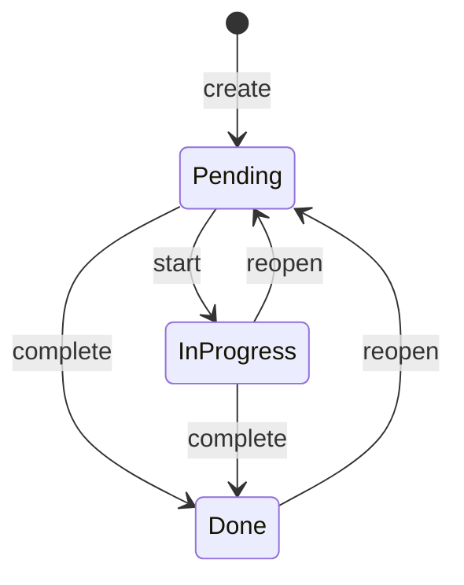

# Business Rules

This document defines **what** the Task List backend does, independent of any technology.
Everything here belongs in the **Domain** and **Application** layers and must be covered by unit tests.

> Scope of v1: a single-user API (no authentication) that manages **Categories** and **Tasks**.
> Multi-user support is listed under [Future scope](#8-future-scope).

---

## 1. Glossary

| Term | Meaning |
|---|---|
| **Task** | A unit of work the user wants to do. Called `TaskItem` in code to avoid clashing with `System.Threading.Tasks.Task`. |
| **Category** | A label used to group tasks (e.g. "Work", "Home", "Study"). |
| **Status** | Lifecycle state of a task: `Pending`, `InProgress`, `Done`. |
| **Priority** | Importance of a task: `Low`, `Medium`, `High`. |
| **Overdue** | A task that is not `Done` and whose due date is before today. Calculated, never stored. |

---

## 2. Entities

### 2.1 Category

| Field | Type | Required | Rules |
|---|---|---|---|
| `Id` | GUID | yes | Generated by the system. Immutable. |
| `Name` | text | yes | 2–50 characters after trimming. Unique, **case-insensitive** (`Work` and `work` collide). |
| `Description` | text | no | Max 200 characters. |
| `Color` | text | no | Hex color in the format `#RRGGBB` (e.g. `#1E90FF`). Stored uppercase. |
| `CreatedAt` | date-time (UTC) | yes | Set by the system on creation. |
| `UpdatedAt` | date-time (UTC) | no | Set by the system on every update. |

### 2.2 Task (`TaskItem`)

| Field | Type | Required | Rules |
|---|---|---|---|
| `Id` | GUID | yes | Generated by the system. Immutable. |
| `Title` | text | yes | 3–120 characters after trimming. |
| `Description` | text | no | Max 1000 characters. |
| `CategoryId` | GUID | yes | Must reference an existing category. |
| `Status` | enum | yes | `Pending` (default), `InProgress`, `Done`. |
| `Priority` | enum | yes | `Low`, `Medium` (default), `High`. |
| `DueDate` | date (no time) | no | See [BR-T04](#33-tasks). |
| `CompletedAt` | date-time (UTC) | no | Set only by the system. See [BR-T07](#33-tasks). |
| `CreatedAt` | date-time (UTC) | yes | Set by the system on creation. |
| `UpdatedAt` | date-time (UTC) | no | Set by the system on every update. |

Derived (read-only) field returned by the API:

- `IsOverdue` = `Status != Done` **and** `DueDate < today (UTC)`.

---

## 3. Business rules

Each rule has an ID so it can be referenced in tickets, tests and error messages.

### 3.1 General

| ID | Rule |
|---|---|
| BR-G01 | All text inputs are **trimmed** before validation and storage. An input that is only whitespace is treated as empty. |
| BR-G02 | `Id`, `CreatedAt`, `UpdatedAt` and `CompletedAt` can never be set by the client. Values sent for them are ignored. |
| BR-G03 | All timestamps are stored and returned in **UTC** (ISO-8601). |
| BR-G04 | The current date/time comes from an abstraction (clock), never directly from the system, so rules are testable. |

### 3.2 Categories

| ID | Rule |
|---|---|
| BR-C01 | A category name must be unique, ignoring case. Creating or renaming to an existing name fails with `Category.NameAlreadyExists`. |
| BR-C02 | Renaming a category to its own current name (even with a different casing) is allowed. |
| BR-C03 | `Color`, when provided, must match `^#[0-9A-Fa-f]{6}$` and is normalized to uppercase. |
| BR-C04 | A category **cannot be deleted while it has tasks**. The request fails with `Category.HasTasks` and the response tells how many tasks are linked. The user must move or delete those tasks first. |
| BR-C05 | Deleting a category is a hard delete (there is no trash/recycle bin in v1). |
| BR-C06 | The category list is ordered by `Name` (ascending) by default. |
| BR-C07 | When reading a category, the API also returns `TaskCount` (total tasks) and `PendingTaskCount` (tasks not `Done`). |

### 3.3 Tasks

| ID | Rule |
|---|---|
| BR-T01 | A task always belongs to exactly **one** category. Creating or updating a task with a non-existing `CategoryId` fails with `Category.NotFound`. |
| BR-T02 | A new task always starts with `Status = Pending`, regardless of what the client sends. |
| BR-T03 | If `Priority` is not informed, it defaults to `Medium`. |
| BR-T04 | `DueDate`, when provided on **creation**, cannot be in the past (today is allowed). On **update**, a past due date is only accepted if it is the value the task already had (so old tasks can still be edited). |
| BR-T05 | Allowed status transitions: <br>`Pending → InProgress`<br>`Pending → Done`<br>`InProgress → Pending` (reopen)<br>`InProgress → Done`<br>`Done → Pending` (reopen)<br>Any other transition (e.g. `Done → InProgress`, or a transition to the same status) fails with `Task.InvalidStatusTransition`. |
| BR-T06 | Status is changed **only** through the dedicated status actions — start (`→ InProgress`), complete (`→ Done`), reopen (`→ Pending`) — and never through the general update endpoint. |
| BR-T07 | When a task becomes `Done`, `CompletedAt` is set to the current UTC time. When it is reopened (`Done → Pending`), `CompletedAt` is cleared. |
| BR-T08 | A task with `Status = Done` is **read-only**: its title, description, priority, due date and category cannot be changed. The update fails with `Task.CompletedTaskIsReadOnly`. The task must be reopened first. |
| BR-T09 | A task can be deleted in any status. Deletion is a hard delete. |
| BR-T10 | A task can be moved to a different category through the update endpoint (respecting BR-T01 and BR-T08). |

### 3.4 Listing and searching

| ID | Rule |
|---|---|
| BR-L01 | All list endpoints are **paginated**. `page` starts at 1 (default 1). `pageSize` default 20, min 1, max 100. Values outside the range fail validation. |
| BR-L02 | Every paginated response returns `items`, `page`, `pageSize`, `totalCount` and `totalPages`. |
| BR-L03 | Tasks can be filtered by (all optional, combined with AND): `categoryId`, `status`, `priority`, `dueFrom`, `dueTo`, `overdue=true`, and `search` (case-insensitive "contains" on `Title` and `Description`). |
| BR-L04 | `dueFrom` must be less than or equal to `dueTo` when both are provided. |
| BR-L05 | Tasks can be sorted by `createdAt`, `dueDate`, `priority` or `title`, ascending or descending. Default: `createdAt desc`. When sorting by `dueDate`, tasks without due date go **last**. |
| BR-L06 | Categories can be filtered by `search` (case-insensitive "contains" on `Name`). |

---

## 4. Use cases

| # | Use case | Main rules |
|---|---|---|
| UC-01 | Create category | BR-C01, BR-C03 |
| UC-02 | Get category by id | BR-C07 |
| UC-03 | List categories | BR-L01, BR-L02, BR-L06, BR-C06 |
| UC-04 | Update category | BR-C01, BR-C02, BR-C03 |
| UC-05 | Delete category | BR-C04, BR-C05 |
| UC-06 | Create task | BR-T01–BR-T04 |
| UC-07 | Get task by id | `IsOverdue` |
| UC-08 | List tasks (filter / sort / paginate) | BR-L01–BR-L05 |
| UC-09 | Update task (title, description, priority, due date, category) | BR-T01, BR-T04, BR-T06, BR-T08, BR-T10 |
| UC-10 | Start task (`→ InProgress`) | BR-T05 |
| UC-11 | Complete task (`→ Done`) | BR-T05, BR-T07 |
| UC-12 | Reopen task (`InProgress`/`Done → Pending`) | BR-T05, BR-T07 |
| UC-13 | Delete task | BR-T09 |
| UC-14 | List tasks of a category | Same as UC-08 with `categoryId` fixed |

---

## 5. Task status lifecycle



> **reopen** means "go back to `Pending`" and is accepted from both `InProgress` and `Done`.

---

## 6. Error catalog

Errors are returned as RFC 9457 **Problem Details** with an extra `code` field.

| Code | HTTP | When |
|---|---|---|
| `Validation.Failed` | 400 | One or more field validations failed. `errors` lists each field. |
| `Category.NotFound` | 404 | Category id does not exist (also used by BR-T01). |
| `Category.NameAlreadyExists` | 409 | BR-C01. |
| `Category.HasTasks` | 409 | BR-C04. |
| `Task.NotFound` | 404 | Task id does not exist. |
| `Task.InvalidStatusTransition` | 409 | BR-T05. |
| `Task.CompletedTaskIsReadOnly` | 409 | BR-T08. |
| `Task.DueDateInPast` | 400 | BR-T04. |
| `Server.Unexpected` | 500 | Any unhandled error. No internal details are leaked. |

---

## 7. API contract (summary)

Base path: `/api/v1`

| Method | Route | Use case | Success |
|---|---|---|---|
| POST | `/categories` | UC-01 | 201 + `Location` |
| GET | `/categories/{id}` | UC-02 | 200 |
| GET | `/categories?page&pageSize&search` | UC-03 | 200 |
| PUT | `/categories/{id}` | UC-04 | 204 |
| DELETE | `/categories/{id}` | UC-05 | 204 |
| GET | `/categories/{id}/tasks` | UC-14 | 200 |
| POST | `/tasks` | UC-06 | 201 + `Location` |
| GET | `/tasks/{id}` | UC-07 | 200 |
| GET | `/tasks?...filters` | UC-08 | 200 |
| PUT | `/tasks/{id}` | UC-09 | 204 |
| POST | `/tasks/{id}/start` | UC-10 | 204 |
| POST | `/tasks/{id}/complete` | UC-11 | 204 |
| POST | `/tasks/{id}/reopen` | UC-12 | 204 |
| DELETE | `/tasks/{id}` | UC-13 | 204 |

Example — create task request:

```json
{
  "title": "Read the Clean Architecture book",
  "description": "Chapters 1 to 5",
  "categoryId": "3f1c2a9e-6b1d-4c1e-9f7a-0c2b1d4e5f60",
  "priority": "High",
  "dueDate": "2026-11-15"
}
```

Example — task response:

```json
{
  "id": "a8d0e7c4-2f3b-4b5a-8c9d-1e2f3a4b5c6d",
  "title": "Read the Clean Architecture book",
  "description": "Chapters 1 to 5",
  "category": { "id": "3f1c2a9e-6b1d-4c1e-9f7a-0c2b1d4e5f60", "name": "Study", "color": "#1E90FF" },
  "status": "Pending",
  "priority": "High",
  "dueDate": "2026-11-15",
  "isOverdue": false,
  "completedAt": null,
  "createdAt": "2026-10-23T14:02:11Z",
  "updatedAt": null
}
```

---

## 8. Future scope

Not part of v1, but the design should not block them:

- Users and authentication (each user sees only their own categories and tasks).
- Soft delete / trash with restore.
- Subtasks / checklist items.
- Tags (many-to-many) in addition to the single category.
- Reminders and notifications for due dates.
- Recurring tasks.
