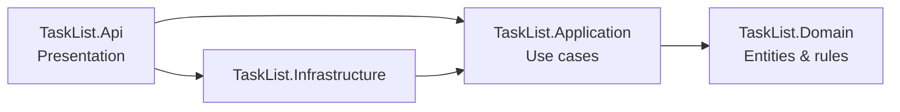

# Tech Stack & Architecture

This document defines **how** the Task List backend is built. The business rules live in
[01-business-rules.md](01-business-rules.md). The development tasks live in [03-development-tasks.md](03-development-tasks.md).

---

## 1. Stack overview

| Concern | Choice | Notes |
|---|---|---|
| Runtime | **.NET 10** (LTS) | C# 14. `TargetFramework` = `net10.0`. |
| Web | **ASP.NET Core Minimal APIs** | Endpoints grouped per feature with `MapGroup`. |
| API docs | `Microsoft.AspNetCore.OpenApi` + **Scalar** UI | Built-in OpenAPI document generation. Scalar served at `/scalar` in Development only. |
| Validation | **FluentValidation** | Input validation in the Application layer. |
| Use case dispatch | **Hand-written handlers** (no MediatR) | One `ICommandHandler<TCommand, TResult>` / `IQueryHandler<TQuery, TResult>` per use case, registered with DI. Keeps the dependency graph free of commercial-licensed libraries and makes the flow explicit for study. |
| Error handling | **Result pattern** + RFC 9457 **Problem Details** | Expected failures return `Result<T>` with an `Error`; unexpected ones are caught by a global `IExceptionHandler`. |
| ORM | **Entity Framework Core 10** | Code-first, migrations, `IEntityTypeConfiguration<T>` per entity. |
| Database | **PostgreSQL 17** | Driver: `Npgsql.EntityFrameworkCore.PostgreSQL`. Case-insensitive uniqueness via a unique index on `lower(name)`. |
| Logging | **Serilog** | Console sink, structured JSON in non-Development environments, request logging middleware. |
| Health | ASP.NET Core Health Checks | `/health` (liveness) and `/health/ready` (includes database check). |
| Time | `TimeProvider` (built into .NET) | Injected everywhere a "now" is needed (BR-G04). `FakeTimeProvider` in tests. |
| Containers | **Docker** + **docker compose** | API + PostgreSQL for local development. |
| CI | **GitHub Actions** | Restore, build, format check, test, coverage report. |

### Testing

| Kind | Tools |
|---|---|
| Unit tests | **xUnit v3** on **Microsoft.Testing.Platform** (enabled in `global.json`), **Shouldly** (assertions), **NSubstitute** (mocks) |
| Integration tests | `Microsoft.AspNetCore.Mvc.Testing` (`WebApplicationFactory`), **Testcontainers for .NET** (real PostgreSQL), **Respawn** (reset DB between tests) |
| Architecture tests | **NetArchTest.Rules** — enforces the dependency rule |
| Coverage | `coverlet.MTP` (`dotnet test --coverlet`) + ReportGenerator |

> Why not FluentAssertions / MediatR / AutoMapper? Their recent major versions moved to commercial licenses.
> For a study project we keep only permissive (MIT/Apache) dependencies. Mapping is done with plain
> extension methods (`ToResponse()`), which is also easier to read and debug.

---

## 2. Clean Architecture

### 2.1 Dependency rule

Source code dependencies point **inwards only**. Inner layers know nothing about outer layers.



| Layer | Responsibility | May reference |
|---|---|---|
| **Domain** | Entities, value objects, enums, domain errors, invariants (status transitions, read-only rules). No framework code. | nothing (only the BCL) |
| **Application** | Use cases (commands/queries + handlers), validators, DTOs, abstractions (`ICategoryRepository`, `ITaskRepository`, `IUnitOfWork`), `Result`/`Error`. | Domain, FluentValidation |
| **Infrastructure** | EF Core `DbContext`, entity configurations, migrations, repository implementations, DI registration of persistence. | Application, Domain, EF Core, Npgsql |
| **Api** | HTTP endpoints, request/response contracts, `Result → IResult` mapping, Problem Details, OpenAPI, composition root (`Program.cs`). | Application, Infrastructure (only for DI wiring) |

`Api → Infrastructure` exists only so `Program.cs` can call `AddInfrastructure()`. Endpoints must never use
Infrastructure types directly — this is checked by an architecture test.

### 2.2 Where each rule lives

| Kind of rule | Layer | Example |
|---|---|---|
| Entity invariants | Domain (inside the entity) | `TaskItem.Complete(now)` sets `CompletedAt` and rejects invalid transitions (BR-T05, BR-T07). |
| Input shape / format | Application (FluentValidation) | Title length, color regex, page size range. |
| Rules that need data | Application (handler) | Category name uniqueness (BR-C01), category has tasks (BR-C04). |
| HTTP concerns | Api | Status codes, `Location` header, Problem Details. |

---

## 3. Solution structure

```text
clean-arc-tasklist/
├── TaskList.slnx
├── Directory.Build.props          # common props: net10.0, nullable, warnings as errors
├── Directory.Packages.props       # central package management (versions in one place)
├── global.json                    # pins the .NET 10 SDK
├── .editorconfig
├── docker-compose.yml
├── docs/
├── src/
│   ├── TaskList.Domain/
│   │   ├── Common/                # Entity base class, Error, Result
│   │   ├── Categories/            # Category, CategoryErrors
│   │   └── Tasks/                 # TaskItem, TaskStatus, TaskPriority, TaskErrors
│   ├── TaskList.Application/
│   │   ├── Abstractions/          # ICommandHandler, IQueryHandler, repositories, IUnitOfWork
│   │   ├── Common/                # PagedResult, ValidationBehavior/decorator
│   │   ├── Categories/
│   │   │   ├── Create/            # CreateCategoryCommand, Handler, Validator
│   │   │   ├── Update/
│   │   │   ├── Delete/
│   │   │   ├── GetById/
│   │   │   └── List/
│   │   ├── Tasks/
│   │   │   ├── Create/ Update/ Delete/ GetById/ List/
│   │   │   └── ChangeStatus/      # Start, Complete, Reopen
│   │   └── DependencyInjection.cs
│   ├── TaskList.Infrastructure/
│   │   ├── Persistence/
│   │   │   ├── AppDbContext.cs
│   │   │   ├── Configurations/    # CategoryConfiguration, TaskItemConfiguration
│   │   │   ├── Migrations/
│   │   │   └── Repositories/
│   │   └── DependencyInjection.cs
│   └── TaskList.Api/
│       ├── Endpoints/             # one file per endpoint (IEndpoint), grouped in Categories/ and Tasks/
│       ├── Contracts/             # request/response records
│       ├── Infrastructure/        # ResultExtensions, GlobalExceptionHandler
│       └── Program.cs
└── tests/
    ├── TaskList.Domain.UnitTests/
    ├── TaskList.Application.UnitTests/
    ├── TaskList.Api.IntegrationTests/
    └── TaskList.ArchitectureTests/
```

The Application layer is organized by **feature (vertical slice) inside a layer**: each use case is a folder
with its command/query, handler and validator. This keeps related code together without breaking the layers.

---

## 4. Key patterns & conventions

### 4.1 Result and Error

```csharp
public sealed record Error(string Code, string Message, ErrorType Type);

public enum ErrorType { Validation, NotFound, Conflict, Unexpected }

public class Result
{
    public bool IsSuccess { get; }
    public Error? Error { get; }
    // Success(), Failure(error), implicit conversions...
}

public sealed class Result<T> : Result { public T Value { get; } }
```

Domain errors are static and named after the error catalog in the business rules:

```csharp
public static class TaskErrors
{
    public static Error NotFound(Guid id) =>
        new("Task.NotFound", $"Task '{id}' was not found.", ErrorType.NotFound);

    public static readonly Error CompletedTaskIsReadOnly =
        new("Task.CompletedTaskIsReadOnly", "A completed task cannot be edited. Reopen it first.", ErrorType.Conflict);
}
```

The Api maps `ErrorType` to HTTP: `Validation → 400`, `NotFound → 404`, `Conflict → 409`, `Unexpected → 500`.

### 4.2 Rich domain entities

- Private setters; state changes only through methods (`Rename`, `Start`, `Complete`, `Reopen`, `UpdateDetails`, `MoveTo`).
- Static factory `Create(...)` returns `Result<T>` and enforces invariants.
- A private parameterless constructor exists only for EF Core.

```csharp
public Result Complete(DateTimeOffset now)
{
    if (Status == TaskStatus.Done)
        return TaskErrors.InvalidStatusTransition(Status, TaskStatus.Done);

    Status = TaskStatus.Done;
    CompletedAt = now;
    UpdatedAt = now;
    return Result.Success();
}
```

### 4.3 Handlers and validation

- `ICommandHandler<TCommand, TResponse>` / `IQueryHandler<TQuery, TResponse>` are registered in `AddApplication()`
  with a small reflection-based assembly scan (no extra library needed).
- Validation runs through a **decorator** (`ValidationCommandHandler<,>`) that executes all FluentValidation
  validators for the command and returns `Validation.Failed` before the handler is called.
- Queries read with `AsNoTracking()` and project directly to response DTOs.

### 4.4 Persistence

- Table names in snake_case (`categories`, `tasks`) via `UseSnakeCaseNamingConvention()` (`EFCore.NamingConventions`).
- Enums stored as strings (`HasConversion<string>()`), so the DB stays readable.
- `DueDate` mapped as `DateOnly` → PostgreSQL `date`.
- Timestamps as `DateTimeOffset` → `timestamptz`.
- FK `tasks.category_id → categories.id` with `OnDelete(DeleteBehavior.Restrict)` (backs BR-C04 at DB level).
- Unique index on `lower(name)` for categories (backs BR-C01 at DB level).
- Indexes: `tasks(category_id)`, `tasks(status)`, `tasks(due_date)`.
- `IUnitOfWork.SaveChangesAsync` is called by the command handler; repositories never save by themselves.
- Migrations are applied automatically on startup **only in Development**; other environments run the
  self-contained migrations bundle built by CI (see README "Database migrations").
- A design-time `DbContext` factory in Infrastructure lets `dotnet ef` run without starting the API host.

### 4.5 API conventions

- One class per endpoint implementing `IEndpoint`, discovered by assembly scanning (no edits to `Program.cs` per endpoint).
- Base path `/api/v1`. JSON with camelCase; enums serialized as strings (`JsonStringEnumConverter`).
- `POST` returns `201 Created` with `Location`; `PUT`/`DELETE`/status actions return `204 No Content`.
- Every error is Problem Details with `type`, `title`, `status`, `detail`, `code`, `traceId` (and `errors` for validation).
- `CancellationToken` flows from the endpoint to EF Core in every call.

### 4.6 Code quality

- `<Nullable>enable</Nullable>`, `<TreatWarningsAsErrors>true</TreatWarningsAsErrors>`, `<ImplicitUsings>enable</ImplicitUsings>`.
- `dotnet format --verify-no-changes` in CI.
- `sealed` by default for classes not designed for inheritance.
- File-scoped namespaces, primary constructors where they improve readability.
- Test names: `MethodName_Scenario_ExpectedResult`.

---

## 5. Configuration

`appsettings.json` (secrets go in user-secrets / environment variables, never committed):

```json
{
  "ConnectionStrings": {
    "Database": "Host=localhost;Port=5432;Database=tasklist;Username=tasklist;Password=tasklist"
  },
  "Serilog": { "MinimumLevel": { "Default": "Information" } }
}
```

Environment variable override: `ConnectionStrings__Database`.

---

## 6. Local development

Prerequisites: .NET 10 SDK, Docker.

```bash
docker compose up -d db                       # start PostgreSQL
dotnet tool restore                           # dotnet-ef, reportgenerator
dotnet run --project src/TaskList.Api         # API + Scalar at /scalar
dotnet test                                   # all tests (integration tests need Docker)
```

Create a migration:

```bash
dotnet ef migrations add <Name> \
  --project src/TaskList.Infrastructure \
  --startup-project src/TaskList.Api \
  --output-dir Persistence/Migrations
```

---

## 7. CI pipeline (GitHub Actions)

On every push and pull request to `main`:

1. `actions/setup-dotnet` with the version from `global.json`.
2. `dotnet restore`
3. `dotnet format --verify-no-changes`
4. `dotnet build -c Release --no-restore`
5. `dotnet test -c Release --no-build --coverlet --coverlet-output-format cobertura` (Docker is available on `ubuntu-latest`, so Testcontainers works)
6. Publish coverage summary to the job summary.

Quality gate: build fails on warnings, formatting issues, failing tests or architecture test violations.

---

## 8. Main NuGet packages

| Project | Packages |
|---|---|
| Domain | — |
| Application | `FluentValidation`, `FluentValidation.DependencyInjectionExtensions` |
| Infrastructure | `Microsoft.EntityFrameworkCore`, `Npgsql.EntityFrameworkCore.PostgreSQL`, `EFCore.NamingConventions`, `Microsoft.EntityFrameworkCore.Design` |
| Api | `Microsoft.AspNetCore.OpenApi`, `Scalar.AspNetCore`, `Serilog.AspNetCore`, `AspNetCore.HealthChecks.NpgSql` |
| Tests | `xunit.v3`, `Shouldly`, `NSubstitute`, `Microsoft.AspNetCore.Mvc.Testing`, `Testcontainers.PostgreSql`, `Respawn`, `NetArchTest.Rules`, `Microsoft.Extensions.TimeProvider.Testing`, `coverlet.MTP` |

Versions are pinned in `Directory.Packages.props` (use the latest stable that targets .NET 10).
