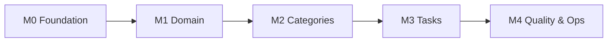

# Development Tasks

Backlog for building the Task List backend. Business rules: [01-business-rules.md](01-business-rules.md).
Stack and architecture: [02-tech-stack.md](02-tech-stack.md).
Who works on what in parallel: [04-parallel-execution-plan.md](04-parallel-execution-plan.md).

## How to use this backlog

- Each task has an ID (`TL-xxx`), a size, dependencies and **acceptance criteria (AC)**.
- Sizes: **S** ≈ up to half a day · **M** ≈ 1 day · **L** ≈ 2–3 days.
- One task = one branch = one pull request. Branch name: `feature/TL-xxx-short-name`.
- A task is **done** when it meets the [Definition of Done](#definition-of-done).
- Build **inside-out**: Domain → Application → Infrastructure → Api. Every layer is tested before the next one uses it.
- A task is **ready** when every task in its *Depends on* line is merged into `main`. Many tasks can run in parallel —
  see the [parallel execution plan](04-parallel-execution-plan.md) for waves, lanes and merge-conflict rules.

## Milestones

| Milestone | Goal | Tasks |
|---|---|---|
| **M0 – Foundation** | Empty solution that builds, runs and is checked by CI | TL-001 → TL-007 |
| **M1 – Domain** | Entities and rules, 100% unit tested | TL-010 → TL-013 |
| **M2 – Categories** | Shared contracts + full Category CRUD through the API | TL-020 → TL-028 |
| **M3 – Tasks** | Full Task CRUD + status lifecycle + listing | TL-030 → TL-039 |
| **M4 – Quality & Ops** | Hardening, docs, Docker image | TL-040 → TL-045 |

Milestones describe *scope*, not a strict sequence: once the shared contracts (TL-007, TL-022, TL-028, TL-030)
are merged, every Category **and** Task use case can be built at the same time.
See the [parallel execution plan](04-parallel-execution-plan.md).

---

## M0 – Foundation

### TL-001 · Create solution and projects — S
**Depends on:** —
- Create `TaskList.slnx`, `global.json` (.NET 10 SDK), `Directory.Build.props`, `Directory.Packages.props`, `.editorconfig`, `.gitignore`.
- Add **every** package from [02 §8](02-tech-stack.md#8-main-nuget-packages) to `Directory.Packages.props` now, so parallel tasks don't all edit it.
- Create the 4 `src` projects and 4 `tests` projects from the [solution structure](02-tech-stack.md#3-solution-structure).
- Add project references following the dependency rule.

**AC**
- [ ] `dotnet build` succeeds with zero warnings.
- [ ] `Nullable`, `ImplicitUsings`, `TreatWarningsAsErrors` enabled for all projects through `Directory.Build.props`.
- [ ] All package versions are only in `Directory.Packages.props`.

### TL-002 · Architecture tests — S
**Depends on:** TL-001
- Using NetArchTest, write tests that enforce:
  - Domain depends on nothing else in the solution.
  - Application does not depend on Infrastructure or Api.
  - Infrastructure does not depend on Api.
  - Api endpoints do not use `TaskList.Infrastructure` namespaces (except `Program`/DI).
  - Domain entities are `sealed` or `abstract`; handlers are `sealed` and `internal`/`public` as agreed.

**AC**
- [ ] Tests pass on the empty solution and fail if a forbidden reference is added (verify manually once).

### TL-003 · Shared kernel: Result, Error, Entity base — S
**Depends on:** TL-001
- `Domain/Common`: `Entity` base (Id: `Guid`), `Error`, `ErrorType`, `Result`, `Result<T>`.
- Implicit conversions `Error → Result` and `T → Result<T>`.

**AC**
- [ ] Unit tests cover success, failure, and accessing `Value` on a failed result (throws `InvalidOperationException`).

### TL-004 · Api bootstrap — M
**Depends on:** TL-001
- `Program.cs` with Serilog, OpenAPI + Scalar (Development only), Problem Details, `JsonStringEnumConverter`,
  `TimeProvider.System` registered as singleton, `/api/v1` route group.
- `GlobalExceptionHandler : IExceptionHandler` returning `Server.Unexpected` (500) without leaking details.
- Health checks `/health` and `/health/ready`.

**AC**
- [ ] `dotnet run` starts the API; `/health` returns 200; `/scalar` opens in Development.
- [ ] An unhandled exception returns Problem Details with `code = Server.Unexpected` and a `traceId`.

### TL-005 · Docker compose for local DB — S
**Depends on:** TL-001
- `docker-compose.yml` with PostgreSQL 17 (named volume, healthcheck) and placeholder `api` service.
- README "Getting started" section.

**AC**
- [ ] `docker compose up -d db` starts a reachable database with the connection string from `appsettings.Development.json`.

### TL-006 · CI pipeline — S
**Depends on:** TL-001, TL-002
- `.github/workflows/ci.yml`: restore, format check, build (Release), test with coverage, coverage summary.

**AC**
- [ ] Pipeline runs on push and PR to `main` and is green.
- [ ] A formatting error or failing test makes the pipeline red.

### TL-007 · Api conventions — S
**Depends on:** TL-003, TL-004
- `ResultExtensions.ToProblem()`: maps `ErrorType` to HTTP (`Validation → 400`, `NotFound → 404`, `Conflict → 409`,
  `Unexpected → 500`) as Problem Details with `code` and `traceId` (and `errors` for validation).
- `IEndpoint` interface + `MapEndpoints()` that discovers endpoints by assembly scanning. **One file per endpoint**
  under `Endpoints/<Feature>/` (e.g. `Endpoints/Tasks/CompleteTask.cs`), mapped into the `/api/v1` group.
- After this task, use case tasks never edit `Program.cs`.

**AC**
- [ ] Unit tests: each `ErrorType` maps to the right status code and Problem Details fields.
- [ ] A new endpoint class is picked up without touching `Program.cs`.

---

## M1 – Domain

### TL-010 · Category entity — M
**Depends on:** TL-003
- `Category` with `Create(name, description, color, now)`, `Update(name, description, color, now)`.
- Trimming (BR-G01), color normalization (BR-C03), field length invariants.
- **All** `CategoryErrors` from the [error catalog](01-business-rules.md#6-error-catalog) (also the ones only used later by handlers).

**AC**
- [ ] Unit tests for every rule: BR-G01, BR-C03, name/description lengths, `CreatedAt`/`UpdatedAt` from the given `now`.

### TL-011 · Task enums and TaskItem entity — M
**Depends on:** TL-003
- `TaskStatus`, `TaskPriority` enums; `TaskItem.Create(title, description, categoryId, priority, dueDate, now)`.
- Defaults: status `Pending` (BR-T02), priority `Medium` (BR-T03).
- Due date not in the past on creation (BR-T04).
- **All** `TaskErrors` from the [error catalog](01-business-rules.md#6-error-catalog).

**AC**
- [ ] Unit tests for BR-T02, BR-T03, BR-T04 (yesterday fails, today passes), lengths and trimming.

### TL-012 · TaskItem status lifecycle — M
**Depends on:** TL-011
- Methods `Start(now)`, `Complete(now)`, `Reopen(now)` implementing BR-T05 and BR-T07.
- `IsOverdue(today)` computed method.

**AC**
- [ ] Table-driven test (`[Theory]`) covering **every** pair of statuses: allowed ones succeed, others return `Task.InvalidStatusTransition`.
- [ ] `CompletedAt` set on complete, cleared on reopen.
- [ ] `IsOverdue` true only when not `Done` and `DueDate < today`.

### TL-013 · TaskItem edit rules — S
**Depends on:** TL-012
- `UpdateDetails(title, description, priority, dueDate, now)` and `MoveTo(categoryId, now)`.
- Rejects any change on `Done` tasks (BR-T08). Past due date allowed only if unchanged (BR-T04).

**AC**
- [ ] Unit tests for BR-T04 (update case), BR-T08, BR-T10.

---

## M2 – Categories

### TL-020 · Application abstractions — S
**Depends on:** TL-003
- `ICommand`, `IQuery<T>`, `ICommandHandler<,>`, `IQueryHandler<,>`, `IUnitOfWork`, `PagedResult<T>`, `PageRequest`.
- `ValidationDecorator` that runs FluentValidation validators and returns `Validation.Failed` with all field errors.
- `AddApplication()` registering handlers, validators and the decorator.

**AC**
- [ ] Unit test: a command with an invalid validator never reaches the handler.

### TL-021 · Persistence setup — M
**Depends on:** TL-010, TL-011, TL-005
- `AppDbContext`, `CategoryConfiguration`, `TaskItemConfiguration` (snake_case, enums as string, `DateOnly`, indexes,
  unique `lower(name)`, FK with `Restrict`). See [persistence conventions](02-tech-stack.md#44-persistence).
- `AddInfrastructure(configuration)`; `UnitOfWork` implementation; initial migration `InitialCreate`.
- Apply migrations on startup in Development.
- Model the **full** v1 schema here. This is the only task that creates a migration (see [hotspots](04-parallel-execution-plan.md#6-avoiding-merge-conflicts)).

**AC**
- [ ] `dotnet ef database update` creates the schema; inserting two categories `Work`/`work` directly in SQL fails.
- [ ] `/health/ready` checks the database.

### TL-022 · Integration test infrastructure — M
**Depends on:** TL-021, TL-004
- `ApiFactory : WebApplicationFactory<Program>, IAsyncLifetime` with a PostgreSQL Testcontainer.
- Respawn reset between tests; `FakeTimeProvider` replacing `TimeProvider`.
- Seed helpers that create categories/tasks **directly through `AppDbContext`** (not through the API), so each use case's
  tests don't depend on other use cases.

**AC**
- [ ] A sample test hits `/health/ready` and passes locally and in CI.

### TL-028 · Application ports & shared contracts — S
**Depends on:** TL-010, TL-011, TL-020
- `ICategoryRepository` (`GetByIdAsync`, `ExistsAsync`, `AddAsync`, `Remove`, `NameExistsAsync(name, excludeId?)`).
- `ITaskRepository` (`GetByIdAsync`, `AddAsync`, `Remove`, `CountByCategoryAsync`).
- The read-side abstraction used by query handlers (decide it here, so query tasks don't each invent one).
- Shared response DTOs (`CategoryResponse`, `TaskResponse`, category summary) and their `ToResponse()` mappings.

**AC**
- [ ] Compiles; architecture tests green. Use case tasks only **add** members to these types.

### TL-023 · Create category (UC-01) — M
**Depends on:** TL-007, TL-022, TL-030
- `CreateCategoryCommand` + validator + handler.
- `POST /api/v1/categories` → 201 with `Location`.

**AC**
- [ ] Unit tests for handler (duplicate name → `Category.NameAlreadyExists`).
- [ ] Integration tests: 201 happy path, 400 validation (with `errors`), 409 duplicate name with different casing.

### TL-024 · Get category by id (UC-02) — S
**Depends on:** TL-007, TL-022, TL-030
- Query with `TaskCount` and `PendingTaskCount` (BR-C07). `GET /api/v1/categories/{id}`.

**AC**
- [ ] Integration tests: 200 with correct counts, 404 `Category.NotFound`.

### TL-025 · List categories (UC-03) — M
**Depends on:** TL-007, TL-022, TL-030
- Pagination (BR-L01, BR-L02), `search` filter (BR-L06), order by name (BR-C06). `GET /api/v1/categories`.

**AC**
- [ ] Integration tests: pagination metadata, search case-insensitive, `pageSize=101` → 400.

### TL-026 · Update category (UC-04) — S
**Depends on:** TL-007, TL-022, TL-030
- `PUT /api/v1/categories/{id}` → 204.

**AC**
- [ ] Integration tests: 204, 404, 409 duplicate, renaming to same name with other casing is allowed (BR-C02), `UpdatedAt` set.

### TL-027 · Delete category (UC-05) — S
**Depends on:** TL-007, TL-022, TL-030
- Blocked when the category has tasks (BR-C04) — response `detail` includes the number of tasks.
- `DELETE /api/v1/categories/{id}` → 204.

**AC**
- [ ] Integration tests: 204 on empty category, 404, 409 `Category.HasTasks`.

---

## M3 – Tasks

### TL-030 · Repository implementations — S
**Depends on:** TL-021, TL-028
- EF Core implementations of `ICategoryRepository` and `ITaskRepository` (and the read-side abstraction) from TL-028.

**AC**
- [ ] Used by the handlers below; covered by their integration tests.

### TL-031 · Create task (UC-06) — M
**Depends on:** TL-007, TL-011, TL-022, TL-030
- Command + validator + handler. Checks category exists (BR-T01). Uses `TimeProvider` for "today".
- `POST /api/v1/tasks` → 201 with `Location`.

**AC**
- [ ] Integration tests: 201 (status `Pending`, priority default `Medium`), 400 validation, 400 `Task.DueDateInPast`, 404 `Category.NotFound`.

### TL-032 · Get task by id (UC-07) — S
**Depends on:** TL-007, TL-022, TL-030
- Response includes nested category summary and `isOverdue`. `GET /api/v1/tasks/{id}`.

**AC**
- [ ] Integration tests: 200, 404; `isOverdue` true after advancing `FakeTimeProvider` past the due date.

### TL-033 · Update task (UC-09) — M
**Depends on:** TL-007, TL-013, TL-022, TL-030
- Updates details and category (BR-T10). Ignores `status` if sent (BR-T06).
- `PUT /api/v1/tasks/{id}` → 204.

**AC**
- [ ] Integration tests: 204, 404 task, 404 category, 409 `Task.CompletedTaskIsReadOnly`, past due date kept unchanged is accepted.

### TL-034 · Status actions (UC-10, UC-11, UC-12) — M
**Depends on:** TL-007, TL-012, TL-022, TL-030
- `POST /api/v1/tasks/{id}/start | complete | reopen` → 204.

**AC**
- [ ] Integration tests for each action: happy path, 404, 409 `Task.InvalidStatusTransition`.
- [ ] `completedAt` set/cleared as per BR-T07 (checked with `FakeTimeProvider`).

### TL-035 · Delete task (UC-13) — S
**Depends on:** TL-007, TL-022, TL-030
- `DELETE /api/v1/tasks/{id}` → 204 in any status (BR-T09).

**AC**
- [ ] Integration tests: 204, 404; the task is gone from the database.
  (The end-to-end "delete all tasks, then delete the category" flow is checked in TL-044, once both endpoints exist.)

### TL-036 · List tasks with filters (UC-08) — L
**Depends on:** TL-007, TL-022, TL-030
- Filters (BR-L03, BR-L04), sorting with nulls last for due date (BR-L05), pagination (BR-L01/02).
- Build the query with composable `IQueryable` extension methods (`WhereStatus`, `WhereSearch`, `ApplySort`...).
- `GET /api/v1/tasks`.

**AC**
- [ ] Integration test per filter and per sort field; combined filters; `dueFrom > dueTo` → 400; invalid sort field → 400.
- [ ] `overdue=true` uses `TimeProvider` (not the DB clock).

### TL-037 · List tasks of a category (UC-14) — S
**Depends on:** TL-036
- `GET /api/v1/categories/{id}/tasks` reusing the TL-036 query with `categoryId` fixed.

**AC**
- [ ] Integration tests: 200 with only that category's tasks, 404 for unknown category.

### TL-038 · OpenAPI polish — S
**Depends on:** all M2 and M3 endpoints (TL-023 → TL-037)
- Names, summaries, tags, `Produces`/`ProducesProblem` metadata on every endpoint; request examples.

**AC**
- [ ] Every endpoint in Scalar shows all possible status codes and schemas.

### TL-039 · HTTP request samples — S
**Depends on:** all M2 and M3 endpoints (TL-023 → TL-037)
- `src/TaskList.Api/TaskList.Api.http` with a request for each endpoint.

**AC**
- [ ] All requests run successfully against a local instance.

---

## M4 – Quality & Ops

### TL-040 · Dockerfile for the API — S
**Depends on:** TL-004
- Multi-stage build, non-root user, `api` service in `docker-compose.yml` wired to `db`.

**AC**
- [ ] `docker compose up` starts the full stack; `/health/ready` returns 200.

### TL-041 · Migration strategy for non-dev environments — S
**Depends on:** TL-021
- Generate an EF migration bundle in CI as an artifact; document how to run it.

**AC**
- [ ] Bundle applies the schema to an empty database.

### TL-042 · Request logging & correlation — S
**Depends on:** TL-004
- Serilog request logging, `traceId` in logs and Problem Details, no sensitive data in logs.

**AC**
- [ ] A failing request can be found in the logs by the `traceId` returned to the client.

### TL-043 · Coverage gate — S
**Depends on:** TL-006
- Fail CI if Domain + Application line coverage drops below **90%**.

**AC**
- [ ] Pipeline fails when the threshold is not met.

### TL-044 · Rule traceability review — S
**Depends on:** M3 done
- Add an end-to-end test: create category → create tasks → delete category fails (409) → delete tasks → delete category (204).
- Check that every rule ID in [01-business-rules.md](01-business-rules.md) has at least one test referencing it
  (e.g. `// BR-T05` comment or test name).

**AC**
- [ ] Checklist in the PR listing each rule ID → test(s).

### TL-045 · README & architecture decision records — S
**Depends on:** M3 done
- README: overview, how to run, how to test, project structure.
- `docs/adr/`: short ADRs for "no MediatR", "Result pattern instead of exceptions", "PostgreSQL + Testcontainers".

**AC**
- [ ] A new developer can clone, run and test the project using only the README.

---

## Definition of Done

- [ ] Code follows the [conventions](02-tech-stack.md#4-key-patterns--conventions) and the dependency rule (architecture tests green).
- [ ] Business rules referenced by ID in tests.
- [ ] Unit tests for Domain/Application logic; integration tests for every endpoint status code listed in the AC.
- [ ] No warnings, `dotnet format` clean, CI green.
- [ ] OpenAPI metadata updated for new/changed endpoints.
- [ ] PR reviewed and approved by at least one other developer.

## Summary

| Milestone | Tasks | Estimated effort |
|---|---|---|
| M0 Foundation | 7 | ~4.5 days |
| M1 Domain | 4 | ~3.5 days |
| M2 Categories | 9 | ~6.5 days |
| M3 Tasks | 10 | ~9 days |
| M4 Quality & Ops | 6 | ~3 days |
| **Total** | **36** | **~26 developer-days** |
