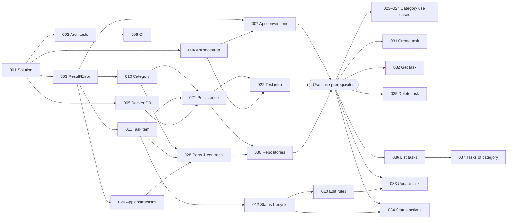

# Parallel Execution Plan

How to run the [development backlog](03-development-tasks.md) with **several developers or AI agents at the
same time**, and in which order. The backlog defines *what* each task is; this doc defines *who can work on
what, when*.

| Without parallelism | With unlimited parallelism | With 3 lanes |
|---|---|---|
| ~26 developer-days | ~7.5 days (critical path) | ~9–10 days |

---

## 1. Why this project can be built in parallel

Clean Architecture splits the code into layers that talk only through **contracts** (interfaces, commands,
DTOs, `Result`/`Error`). Once those contracts exist, the code on each side of them can be written
independently. The plan follows three rules:

1. **Contracts first, then fan out.** A few small foundation tasks freeze everything shared: the schema
   (TL-021), the repository ports and shared DTOs (TL-028), the API conventions (TL-007) and the test
   infrastructure (TL-022). After that, every use case is independent.
2. **One use case = one vertical slice = its own files.** A use case task adds its own command, handler,
   validator, endpoint file and tests. It does not edit files that other use case tasks also edit.
3. **Tests never depend on another use case.** Integration tests seed data **directly through
   `AppDbContext`** (TL-022 helpers), not through another endpoint. So "Get task" does not wait for
   "Create task", and "Delete category" does not wait for "Create task".

---

## 2. Changes made to the backlog to unlock parallelism

| Change | Before | After | Why |
|---|---|---|---|
| **New TL-007** · Api conventions | `Result → IResult` mapping and endpoint layout were built by the first endpoint task | Built once in M0 | Otherwise every endpoint task creates or edits the same files |
| **New TL-028** · Application ports & shared contracts | Ports defined inside each use case task (`ICategoryRepository` in TL-023, `ITaskRepository` in TL-030) | All ports, shared DTOs and the read-side abstraction defined up front | Use cases code against stable interfaces |
| **TL-022** test helpers | Seed data through the API | Seed data through `AppDbContext` | Removes use case → use case dependencies |
| **TL-030** | Task repository (interface + implementation) | Category **and** Task repository implementations | Single owner of repository code |
| **TL-023–027** | Chained on TL-023 (and TL-027 on TL-031) | Depend only on TL-007, TL-022, TL-030 | All category use cases run in parallel |
| **TL-031–036** | Chained on TL-031, which waited for TL-013 and TL-023 | Depend on TL-007, TL-022, TL-030 + the domain task they really use | All task use cases run in parallel |
| **TL-023, TL-031** | Did not list TL-022 although their AC need integration tests | TL-022 listed | Hidden dependency made explicit |
| **TL-039** | Depended on TL-036 only | Depends on all endpoints | It documents every endpoint |
| **M4 tasks** TL-040–043 | Listed at the end | Scheduled as early as their dependencies allow | They never depended on M3 |

The **use case prerequisites** used below are: **TL-007 + TL-022 + TL-030** (these already imply TL-020,
TL-021 and TL-028).

---

## 3. Dependency graph



M4 and polish tasks are left out of the graph for readability; see the waves below.

---

## 4. Execution waves

A **wave** is a set of tasks whose dependencies are all in earlier waves, so everything inside a wave can run
at the same time. Waves are a guide, not a gate: **a task is ready as soon as all its own dependencies are
merged into `main`**, even if the rest of the previous wave is still in progress.

| Wave | Tasks (in parallel) | Parallel width | Theme |
|---|---|---|---|
| **W0** | TL-001 | 1 | Solution skeleton |
| **W1** | TL-002, TL-003, TL-004, TL-005 | 4 | Arch tests, shared kernel, Api host, DB container |
| **W2** | TL-006, TL-007, TL-010, TL-011, TL-020, TL-040, TL-042 | 7 | CI, Api conventions, entities, app abstractions, Docker image, logging |
| **W3** | TL-012, TL-021, TL-028, TL-043 | 4 | Status lifecycle, persistence, ports & contracts, coverage gate |
| **W4** | TL-013, TL-022, TL-030, TL-041 | 4 | Edit rules, test infra, repositories, migration bundle |
| **W5** | TL-023, TL-024, TL-025, TL-026, TL-027, TL-031, TL-032, TL-033, TL-034, TL-035, TL-036 | **11** | All use cases |
| **W6** | TL-037 | 1 | Tasks of a category |
| **W7** | TL-038, TL-039, TL-044, TL-045 | 4 | OpenAPI, `.http` samples, rule traceability, README/ADRs |

### Critical path

The longest chain of dependent work, which decides the minimum duration no matter how many people join:

```text
TL-001 → TL-003 → TL-011 → TL-021 → TL-022 → TL-036 → TL-037 → TL-038 / TL-044 / TL-045
  S        S        M        M        M        L        S          S
 0.5   +  0.5   +   1    +   1    +   1    +  2.5   +  0.5   +    0.5        ≈ 7.5 days
```

Consequences:

- **Delays on TL-011, TL-021, TL-022 or TL-036 delay the whole project.** Give them to your most experienced
  people (or review them first).
- **Start TL-036 (List tasks, size L) first in W5.** It is the longest use case and is followed by TL-037.
- Everything else has slack and can absorb delays.

---

## 5. Suggested assignment for 3 lanes

A **lane** is one developer or one AI agent session. Each lane has a theme so that the same person keeps
context, but lanes freely pick any ready task when they are idle.

| Wave | Lane A · Platform & Api | Lane B · Domain & Tasks | Lane C · Persistence & Categories |
|---|---|---|---|
| W0 | TL-001 | *review TL-001, read docs* | *review TL-001, read docs* |
| W1 | TL-004, TL-002 | TL-003 | TL-005 |
| W2 | TL-007, TL-006 | TL-011 ⚠ critical, TL-020 | TL-010 |
| W3 | *(finishing TL-006)* | TL-028, TL-012 | TL-021 ⚠ critical |
| W4 | TL-030, TL-042 | TL-013 | TL-022 ⚠ critical |
| W5 | TL-036 ⚠ critical, TL-035, TL-032 | TL-031, TL-034, TL-033 | TL-023, TL-024, TL-025, TL-026, TL-027 |
| W6–W7 | TL-037, TL-044 | TL-038, TL-040 | TL-039, TL-041, TL-043, TL-045 |

Lane C owns the critical persistence chain (TL-005 → TL-010 → TL-021 → TL-022), so it gets nothing else
until W5. TL-040, TL-041 and TL-043 have lots of slack: any lane that is idle can pick them earlier.

Load in W5 is balanced at roughly 3–3.5 days per lane.

**With 2 lanes:** merge lanes A and C. **With 4+ lanes:** the extra lanes help mainly in W2 and W5 (the wide
waves). The project will still not finish faster than the critical path (~7.5 days).

---

## 6. Avoiding merge conflicts

Parallel work fails when several branches edit the same file. These files are **hotspots**; each has one
owner task, and every other task follows the rule in the last column.

| Hotspot | Owner task | Rule for everyone else |
|---|---|---|
| `Directory.Packages.props` | TL-001 | TL-001 adds every package from [02 §8](02-tech-stack.md#8-main-nuget-packages) up front. Later tasks only add a package if it is truly new. |
| EF Core `Migrations/` and the model snapshot | TL-021 | **Only TL-021 creates migrations**, with the full schema at once. Snapshot conflicts cannot be merged by hand; any later schema change is its own task and is never run in parallel with another schema change. |
| `AppDbContext`, entity configurations | TL-021 | Do not edit from use case tasks. |
| `Program.cs` | TL-004, TL-007 | Use case tasks never touch it. Handlers, validators and endpoints are discovered by assembly scanning. |
| `Application/DependencyInjection.cs` | TL-020 | Same: assembly scanning, no per-handler registration. |
| Endpoint files | TL-007 (pattern) | **One file per endpoint** (`Endpoints/Tasks/CompleteTask.cs`), implementing `IEndpoint`. No shared `TaskEndpoints.cs`. |
| `CategoryErrors`, `TaskErrors` | TL-010, TL-011 | All errors from the [error catalog](01-business-rules.md#6-error-catalog) are created in the domain tasks. Use case tasks only use them. |
| Ports, shared DTOs, `ToResponse()` | TL-028 | Use case tasks only **add** members (additive changes merge cleanly); renaming or changing a signature needs agreement. |
| `ApiFactory`, seed helpers | TL-022 | Use case tasks add new helper methods in their own test files if needed. |
| `TaskList.Api.http` | TL-039 | Single owner at the end. |

---

## 7. Workflow

1. **Pick a ready task.** It is ready when every task in its *Depends on* line is merged into `main`.
2. **Branch from the latest `main`:** `feature/TL-xxx-short-name` (one task = one branch = one PR).
3. **Stay inside the slice.** If you need to change a hotspot file, stop and coordinate with its owner.
4. **Merge `main` into your branch before opening the PR**, run the full test suite (architecture tests
   included), then open the PR.
5. **Merge small and often.** Foundation tasks (W0–W4) should be reviewed with priority — every hour they
   wait is an hour that blocks other lanes.

### Running lanes with AI agents

This project is AI Native, so lanes can be Claude Code sessions:

- One session per task, each in its **own git worktree / branch**, so sessions never share a working tree.
- The prompt for a session is the task ID plus links to its section in
  [03-development-tasks.md](03-development-tasks.md) and to this doc's hotspot rules.
- A human reviews and merges each PR. When a foundation PR merges, start sessions for the tasks it unblocked
  (use the graph in §3).
- In W5, up to 11 sessions can run at the same time; in practice 3–5 keeps reviews manageable.
